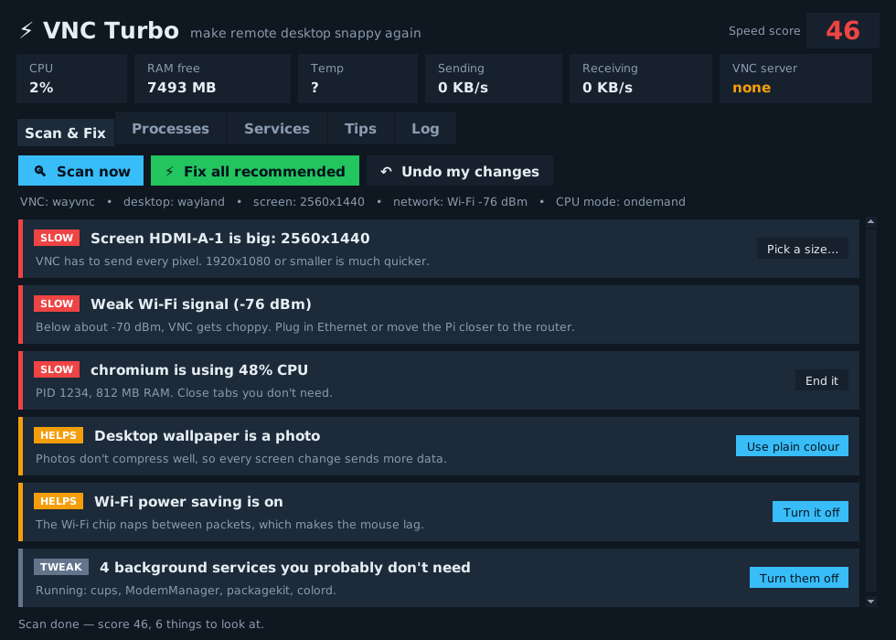

# ⚡ VNC Turbo



Finds what's making VNC slow on a Raspberry Pi 5 and switches it off — with one-click undo.

## Install

```
unzip vnc-turbo.zip
cd vnc-turbo
bash install.sh
```

Open **VNC Turbo** from the menu or the Desktop icon. Run it *inside* your VNC session so it can see the screen.

## What it checks

| Check | Fix |
|---|---|
| Screen resolution too big | Pick 1280×720 / 1600×900 / 1920×1080, optionally kept after reboot |
| Photo wallpaper | Plain colour |
| Wi-Fi power saving | Turn off (stays off) |
| Weak Wi-Fi signal | Advice (Ethernet!) |
| CPU and RAM hogs | End the app (asks first; desktop/VNC/network apps are protected) |
| Heat, under-voltage, throttling | Advice |
| CPU speed mode | Full speed (resets on reboot) |
| Unneeded services (printing, modems, update checker…) | Turn off / back on |
| VNC server not running | Turn it on |

Plus a live strip at the top: CPU, free RAM, temperature, and how much data VNC is sending.

## Undo

Every change is logged in `~/.config/vnc-turbo/undo.json`. **Undo my changes** puts all of it back.

## Over SSH

```
vnc-turbo --scan
```
